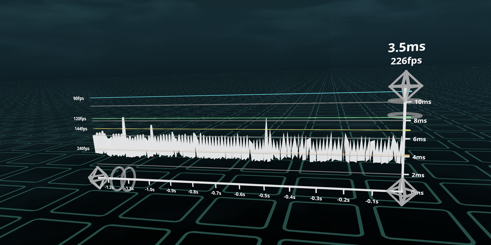

# plancktime
Live frametime graph for Stardust XR.



> [!IMPORTANT]  
> Requires the [Stardust XR Server](https://github.com/StardustXR/server) to be running.

## How to Use
Run the command `plancktime`. Right now it can only be launched from the command line, not from the desktop.

### Controls
- **End handles:** the two handles at either end of the time axis. Place them anywhere and the graph stretches between them, the farther apart the more history it shows.
- **Height handle:** the handle on top of the ms axis. Pull it up or down to show more or less of the ms range, pull it toward or away from you to tilt the graph around the time axis.
- **Time dial:** skewered on the time axis next to the left handle. Twist it to zoom time in or out, each turn doubles or halves it.
- **Density dial:** skewered on the ms axis just under the height handle. Twist it to zoom the ms axis the same way.
- **Body:** repose the middle of the graph to move the whole thing around, derez it to close plancktime.

### Reading the Graph
- **The line:** each point is one frame, newest at the right next to the ms axis, scrolling left as it ages. It warms from white to red as frames get slower than 90fps, fully red by 30fps.
- **Refresh rate lines:** colored lines at 60, 72, 90, 120, 144 and 240fps, labeled on the left, so you can see which rate you're hitting at a glance.
- **Readout:** above the height handle, the last frame's time and the fps averaged over the last half second.
- **Frame times:** come straight from the server's frame delta, so they're the time between frames the server actually delivered. Frames slower than the top of the ms axis get pinned to it.

## Manual Installation
Clone the repository and after the server is running:
```sh
cargo run
```
